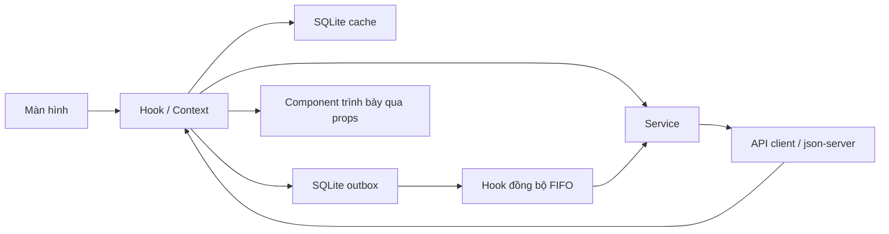

# Study / Space — Thực hành 4

Ứng dụng quản lý học tập nâng cấp từ TH3, làm trực tiếp trong `D:\TH_APP\TH3`. React Native CLI, TypeScript, React Navigation Bottom Tab + 5 Native Stack, SQLite (OP-SQLite), NetInfo, Notifee và json-server **0.17.4**. Không dùng Expo. AsyncStorage chỉ còn dùng để chuyển dữ liệu của bản cũ sang SQLite. Các file `.js` trong cây đề bài được chuyển tương ứng sang `.ts` hoặc `.tsx`; cấu hình công cụ vẫn theo chuẩn CLI.

## Chạy trên Windows và điện thoại Android qua USB

Yêu cầu: Node theo `package.json`, JDK 17, Android SDK, điện thoại bật USB debugging và chấp nhận khóa RSA. Lần đầu sau khi tải mã nguồn: `npm.cmd ci`. Dự án hiện tại đã có thư viện.

Mở **3 terminal** trong `D:\TH_APP\TH3`:

```powershell
# Terminal 1: giữ server dữ liệu chạy
npm.cmd run api
```

```powershell
# Terminal 2: giữ Metro chạy
npm.cmd start
```

```powershell
# Terminal 3: build, cài và mở ứng dụng
adb devices
npm.cmd run android
```

Điện thoại phải có trạng thái `device`. Nếu `unauthorized`, chấp nhận thông báo USB debugging trên điện thoại. Script Android tự chuyển tiếp cổng API 3000 qua USB cho các thiết bị đang kết nối. `src/config.ts` mặc định `http://127.0.0.1:3000`, phù hợp cách chạy này. Metro dùng cổng 8081 do React Native CLI chuyển tiếp.

Nếu rút/cắm lại USB trong lúc ứng dụng đã cài, chạy lại:

```powershell
adb reverse tcp:3000 tcp:3000
adb reverse tcp:8081 tcp:8081
```

Không cần cài json-server toàn cục: lệnh `api` dùng đúng bản được khóa trong dự án, tương đương:

```text
json-server --watch db.json --host 0.0.0.0 --port 3000 --delay 800
```

## Emulator, Wi-Fi và iOS

- Android emulator: dùng cùng lệnh `npm.cmd run android` và địa chỉ mặc định với `adb reverse`. Nếu không dùng reverse, đổi `BASE_URL` trong `src/config.ts` thành `http://10.0.2.2:3000`.
- Điện thoại qua Wi-Fi: đổi `BASE_URL` thành `http://<IPv4-LAN-của-PC>:3000`, cho phép Node qua firewall mạng riêng, hai máy cùng LAN. Điện thoại không truy cập được PC qua địa chỉ `127.0.0.1` nếu không có USB reverse.
- iOS cần macOS/Xcode và cài Pods sau khi thêm NetInfo. iOS Simulator dùng `http://127.0.0.1:3000`; máy thật dùng IP LAN. Chưa kiểm tra build iOS trong môi trường Windows này.
- Khi Metro/cổng 3000 báo đang được sử dụng, kiểm tra terminal server đã chạy trước đó. Giữ một tiến trình cho mỗi cổng.

Gradle, npm cache và thư mục tạm của các lệnh `start`, `android`, `android:build` được đặt trong `.cache` trên ổ D. Ưu tiên các npm script này để giữ cấu hình xử lý dung lượng của TH3.

## APK chạy độc lập để demo offline

```powershell
npm.cmd run android:apk
adb install -r android/app/build/outputs/apk/release/app-release.apk
adb reverse tcp:3000 tcp:3000
```

Bản này có JS bundle nên đóng/mở ứng dụng khi máy bay không phụ thuộc Metro. Chạy API để nạp cache trước, sau đó bật máy bay để thử offline. APK dùng khóa debug của bài thực hành; build cho kiến trúc thiết bị đang cắm (`--active-arch-only`). Ứng dụng cho phép HTTP phục vụ json-server cục bộ; khi chuyển sang backend thật cần HTTPS và cấu hình phát hành riêng. File vào ứng dụng là `index.ts`; Android và Xcode đã cấu hình bundle từ file này.

## Chức năng

- Tổng quan: thông tin sinh viên `/students/1`, môn học, bài tập chưa xong đến hạn trong **7 ngày tiếp theo**, số thay đổi chưa đồng bộ và nút đồng bộ thủ công.
- Môn học: FlatList, tìm theo tên/mã không dấu, lọc học kỳ, chi tiết lấy từ `/courses/:id`, lịch và bài tập liên quan.
- Lịch học: DaySelector từ Thứ 2 tới Chủ nhật, mặc định hôm nay; chi tiết lấy từ `/sessions/:id?_expand=course`.
- Bài tập: tìm kiếm, lọc Tất cả/Chưa xong/Đã xong/Quá hạn, đổi trạng thái lạc quan, thêm mới qua POST. Hạn nhập `dd/MM/yyyy` được đổi thành ISO tại 23:59 theo múi giờ thiết bị, từ chối ngày không tồn tại hoặc trong quá khứ.
- Cá nhân: sửa tên/email/điện thoại qua PATCH, xem điểm theo học kỳ và chi tiết kết quả. GPA hệ 4 có các mức B+, C+, D+, trọng số tín chỉ; môn F vẫn trong mẫu số GPA nhưng không được tính tín chỉ tích lũy.
- Mỗi tab có Native Stack riêng. Tên route tập trung tại `navigation/routes.ts`. Chi tiết chỉ nhận `{ id }`, tự truy vấn và đặt tiêu đề qua `navigation.setOptions`. Lưu form thành công tự quay lại; tab Bài tập có badge số bài chưa hoàn thành.
- Các danh sách có tải/lỗi/thử lại/rỗng, kéo làm mới. Các mục FlatList là component memo, phần trình bày nhận props/callback, không đọc Context hoặc gọi API. OfflineBanner là ngoại lệ dùng `useNetworkStatus` theo đề.

## Dữ liệu và endpoint

`db.json` chứa 5 sinh viên, 5 môn, 7 buổi học, 7 bài tập, 5 kết quả. Mã môn, nội dung và sinh viên chính Nguyễn Minh Anh / 2351120042 giữ từ TH3. Ứng dụng dùng sinh viên id 1; 4 sinh viên còn lại đáp ứng yêu cầu mỗi tập ít nhất 5 bản ghi.

| Tài nguyên | Truy vấn                                                                                                                                     |
| ---------- | -------------------------------------------------------------------------------------------------------------------------------------------- |
| Sinh viên  | GET/PATCH `/students/1`                                                                                                                      |
| Môn học    | GET `/courses`, `/courses/:id`                                                                                                               |
| Lịch học   | GET `/sessions?_expand=course`, `/sessions/:id?_expand=course`                                                                               |
| Bài tập    | GET `/assignments?_expand=course&_sort=dueDate&_order=asc`, `/assignments/:id?_expand=course`; PATCH `/assignments/:id`; POST `/assignments` |
| Điểm       | GET `/grades?_expand=course`, `/grades/:id?_expand=course`                                                                                   |

Quy ước `dayOfWeek`: 2 = Thứ 2, ..., 8 = Chủ nhật, không dùng trực tiếp `Date.getDay()`. Mọi hạn nộp/`updatedAt` là ISO. Tổng điểm = 10% chuyên cần + 30% giữa kỳ + 60% cuối kỳ, điểm chữ thống nhất với bảng quy đổi.

Dữ liệu mẫu có các hạn đầu tháng 11/2026 để demo buổi thực hành. Khi chạy ở thời điểm khác, có thể sửa `dueDate` trong `db.json`; ứng dụng không tự đẩy hạn nộp sau mỗi lần mở. Không còn import dữ liệu seed vào giao diện. Lần đầu chưa có cache mà API tắt sẽ hiển thị lỗi, không giả lập thành công bằng dữ liệu viết cứng.

## Cấu trúc

Các file bắt buộc của đề được giữ tên và vị trí, với phần mở rộng TypeScript:

```text
App.tsx, db.json, README.md
src/
  config.ts
  api/          client, studentService, courseService, sessionService, assignmentService, gradeService
  storage/      keys, cache, outbox, database, codecs, preferences
  context/      AppDataContext, SyncContext
  hooks/        useNetworkStatus, useCachedQuery, useOutboxSync, useAssignmentReminders và các hook màn hình
  notifications/ reminders (Notifee, lịch nhắc cục bộ)
  navigation/   routes, AppNavigator, HomeStack, CourseStack, ScheduleStack, AssignmentStack, ProfileStack
  screens/
    home/         HomeScreen
    courses/      CourseListScreen, CourseDetailScreen
    schedule/     ScheduleScreen, SessionDetailScreen
    assignments/  AssignmentListScreen, AssignmentDetailScreen, AssignmentFormScreen
    profile/      ProfileScreen, EditProfileScreen, GradeListScreen, GradeDetailScreen
  components/
    common/       ScreenContainer, OfflineBanner, LoadingView, ErrorView, EmptyState, SearchBar,
                  FilterChips, SyncBadge, LastUpdatedText, AppButton, FormInput
    course/       CourseCard
    schedule/     DaySelector, SessionCard
    assignment/   AssignmentItem, StatusToggle
    grade/        GpaSummary, GradeRow
    profile/      InfoRow, ReminderSettings
  theme/        colors, spacing, typography
  utils/        date, gpa, validators
```

## Cache và luồng dữ liệu



Service chỉ gọi `request`; màn hình không gọi fetch/AsyncStorage. Client có timeout 10 giây, kiểm tra HTTP, chuẩn hóa lỗi `{ type: 'network' | 'timeout' | 'http', status, message }`.

Cache được lưu trong bảng `query_cache` của `studyspace.sqlite`: `cache_key`, `data_json`, `saved_at`. Hàm `getCache` vẫn trả `{ data, savedAt }`. Cache hiện ngay; mạng cập nhật sau. TTL 5 phút là mốc đánh giá độ cũ, không xóa cache quá hạn khi offline. Kéo làm mới luôn truy vấn lại khi có mạng. Truy vấn SQLite được tuần tự hóa, GET trả chậm không ghi đè một entity vừa đồng bộ.

Database có thêm `outbox` (cột `sequence` tự tăng để giữ FIFO), `preferences` (cài đặt nhắc hạn), `app_meta` (phiên bản chuyển đổi dữ liệu). Dùng WAL và `synchronous=FULL`; câu SQL có tham số ràng buộc. Lần đầu nâng cấp, các khóa `cache:*` và hàng đợi `@studyspace/th4/outbox-v1` được nhập vào SQLite trong cùng một transaction với marker hoàn tất. Nếu lỗi thì rollback, không đánh dấu thành công; lần sau thử lại. Dữ liệu AsyncStorage cũ được giữ làm bản dự phòng và không được nhập lại sau khi chuyển thành công. Dữ liệu mới chỉ ghi SQLite, nên thao tác đã đồng bộ không xuất hiện lại khi khởi động lại.

NetInfo theo dõi `isConnected`, để vẫn dùng được API LAN khi Wi-Fi không có internet công cộng. Mất kết nối hiển thị banner ở mọi màn hình. Dòng thời điểm cập nhật lấy từ lần lưu cache máy chủ, không đổi thành thời điểm thao tác offline.

## Hàng đợi và xử lý xung đột

Mọi thay đổi được ghi bền vào bảng SQLite `outbox` dưới dạng `{ id, method, url, body, createdAt }`, kèm `sequence` tăng tự động. Giao diện chiếu các thao tác chưa gửi lên dữ liệu cache, nên sửa trong tab Bài tập cũng cập nhật Tổng quan ngay. Khi khởi động lại, cache kết hợp hàng đợi khôi phục cả bài mới và trạng thái chờ đồng bộ.

Khi có mạng trở lại, khi ứng dụng ra foreground, mỗi 30 giây hoặc khi bấm Đồng bộ ngay: một tiến trình duy nhất gửi **lần lượt FIFO**. Thành công thì ghi entity vào cache trước, sau đó xóa thao tác khỏi hàng đợi. Lỗi thì dừng tại thao tác đó, giữ thứ tự để thử lại. Thông báo tổng hợp số thao tác thành công và xung đột.

Đổi trạng thái có optimistic update trước khi API phản hồi. Nếu yêu cầu trực tiếp bị API từ chối bằng HTTP, xóa thao tác tương ứng, hoàn tác giao diện và báo lỗi. Lỗi mạng/timeout có thể xảy ra sau khi server đã ghi, nên giữ thao tác để thử lại. Bài mới dùng mã chuỗi client cố định; trước POST kiểm tra id đã tồn tại, tránh tạo trùng sau timeout/khởi động lại. Mã client được dùng luôn làm id server, không cần remap các PATCH tiếp theo.

**Xung đột B5:** trước PATCH, GET bản hiện tại và so `remote.updatedAt` với `action.createdAt`. Nếu server mới hơn thao tác offline, không PATCH; đưa bản server vào cache, bỏ thao tác xung đột và thông báo đã giữ dữ liệu server. Nếu không, gửi PATCH cùng `updatedAt` của thao tác. Các thao tác tiếp theo vẫn được xét theo thứ tự. Quy tắc phụ thuộc đồng hồ PC/điện thoại chính xác; nên bật giờ tự động.

json-server 0.17.4 không tự thay `updatedAt` khi sửa file bằng tay. Trong demo xung đột, **phải đổi cả `fullName` và `updatedAt` sang thời điểm ISO mới hơn thời điểm sửa offline**. json-server cũng không hỗ trợ compare-and-swap nguyên tử; kiểm tra GET rồi PATCH phù hợp kịch bản bài thực hành, chưa ngăn được một người khác ghi đúng giữa hai request. Hệ thống thực tế cần kiểm tra phiên bản tại backend.

Bảng điểm trong đề viết các đoạn như 8,0–8,4 trong khi tổng điểm có thể có hai chữ số lẻ (ví dụ 8,45). Ứng dụng dùng các ngưỡng liên tục: B+ khi `8 <= điểm < 8.5`, B khi `7 <= điểm < 8`, ...; không để khoảng điểm bị bỏ trống và không tự làm tròn trước khi quy đổi.

Tắt json-server trong khi điện thoại vẫn có Wi-Fi là lỗi kết nối API, không phải thiết bị mất mạng. Ứng dụng báo lỗi dễ hiểu, giữ cache và các thao tác chờ gửi; banner offline phụ thuộc trạng thái kết nối của NetInfo.

## Điểm cộng: SQLite và nhắc hạn cục bộ

Giữ React Native CLI nên dùng **`@op-engineering/op-sqlite`** thay `expo-sqlite`, và **`@notifee/react-native`** thay `expo-notifications`. Hai thư viện thực hiện đúng chức năng SQLite và thông báo cục bộ; nếu giảng viên yêu cầu chính xác thư viện Expo thì cần giải thích ngoại lệ CLI này. Sau khi cập nhật mã và cài thư viện, phải build/cài APK mới vì có native module; chỉ reload Metro không thêm được SQLite/Notifee vào APK cũ. iOS cần chạy Pods trên macOS và build lại, chưa được kiểm tra trong môi trường Windows.

Vào **Cá nhân → Nhắc hạn bài tập**:

1. Bật công tắc, chấp nhận quyền thông báo nếu Android/iOS yêu cầu. Ứng dụng không tự hỏi quyền ngay lúc mở.
2. Android 12 trở lên: nếu thấy **Cho phép nhắc đúng giờ**, mở và bật quyền “Báo thức và lời nhắc”, rồi quay lại ứng dụng. Khi chưa có quyền này, ứng dụng dùng lịch inexact và báo rõ Android có thể gửi chậm.
3. Bấm **Gửi thông báo thử** để kiểm tra quyền, channel và biểu tượng. Đây là thông báo ngay, không thay đổi hạn bài tập.
4. Các bài `todo` có thời điểm `dueDate - 24 giờ` còn trong tương lai được lên lịch bằng timestamp, chạy bởi hệ điều hành kể cả khi không có mạng hoặc ứng dụng không mở. Bài đã hoàn thành/bị xóa được hủy lịch; đổi tên/hạn nộp cập nhật cùng mã thông báo; mở lại không tạo bản trùng. Bài mới còn dưới 24 giờ không được tạo thông báo lùi về quá khứ.
5. Tắt công tắc để hủy lịch bài tập của ứng dụng. Trạng thái bật/tắt lưu trong SQLite. Quyền bị từ chối/channel bị tắt có nút mở cài đặt; lỗi đặt lịch có nút thử lại.

Ứng dụng đặt tối đa **45 bài gần nhất** để nằm trong giới hạn trigger Android/iOS; danh sách sẽ được đối chiếu lại khi dữ liệu thay đổi hoặc ứng dụng ra foreground. Nếu quá 45 bài, cần mở ứng dụng định kỳ để bổ sung những lịch tiếp theo. Không dùng “Buộc dừng” trong cài đặt Android khi kiểm tra: Android có thể chặn alarm/background của ứng dụng bị force-stop cho đến lần mở tiếp theo. Cài đặt tiết kiệm pin của một số hãng cũng có thể làm trễ thông báo.

Các file chính: `storage/database.ts`, `storage/cache.ts`, `storage/outbox.ts`, `storage/preferences.ts`, `notifications/reminders.ts`, `hooks/useAssignmentReminders.ts`, `components/profile/ReminderSettings.tsx`. Icon Android đơn sắc ở `android/app/src/main/res/drawable/ic_stat_book.xml`.

Tài liệu chính thức: [OP-SQLite](https://op-engineering.github.io/op-sqlite/docs/installation/), [Notifee timestamp trigger](https://notifee.app/react-native/docs/triggers), [quyền thông báo Android](https://notifee.app/react-native/docs/android/permissions/).

## Kiểm tra và demo mở rộng

```powershell
npm.cmd run typecheck
npm.cmd run lint
npm.cmd run test:ci
npm.cmd run test:api
npm.cmd run android:build
```

Kiểm thử bao gồm client GET/POST/HTTP/network/timeout; cache trước mạng, mở lần đầu server tắt, offline và refresh lỗi; hàng đợi, khởi động lại, FIFO, replay POST, xung đột, lỗi dung lượng; Context optimistic/rollback và tự đồng bộ khi NetInfo đổi offline → online; các mốc điểm GPA và kiểm tra form/ngày. Bộ kiểm thử SQLite chạy câu SQL thật qua `node:sqlite` (Node 22.13+), gồm chuyển dữ liệu cũ, rollback migration và không nhập lại thao tác đã gửi. Notifee được mock ở unit test để kiểm tra timestamp trừ 24 giờ, hủy/cập nhật lịch, tránh trùng, quyền thông báo, quyền exact alarm và phục hồi khi native lỗi; vẫn cần kiểm tra hiển thị thực tế trên thiết bị.

`test:api` khởi động json-server thật trên cổng tạm, kiểm tra endpoint, `_expand`, sắp xếp, POST mã client dạng chuỗi và PATCH ghi xuống đĩa. Chỉ thay đổi bản sao `.cache/api-check/db.json`, không sửa dữ liệu demo gốc.

Xem [DEMO.md](DEMO.md) để thực hiện đủ 7 kịch bản và quay video 3–5 phút. Build Android đã được chạy trong môi trường Windows; không coi unit test là bằng chứng đã quay xong video trên thiết bị.

Tài liệu thư viện: [NetInfo](https://github.com/react-native-netinfo/react-native-netinfo), [json-server 0.17.4](https://github.com/typicode/json-server/tree/v0.17.4).
